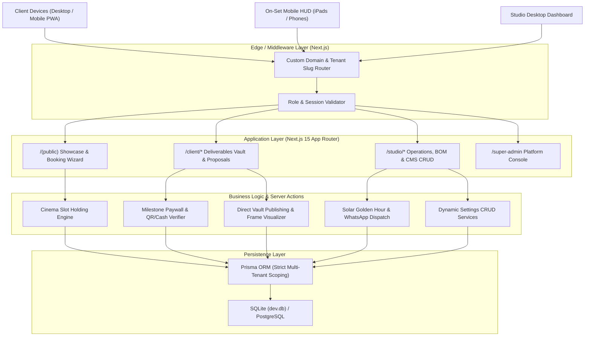
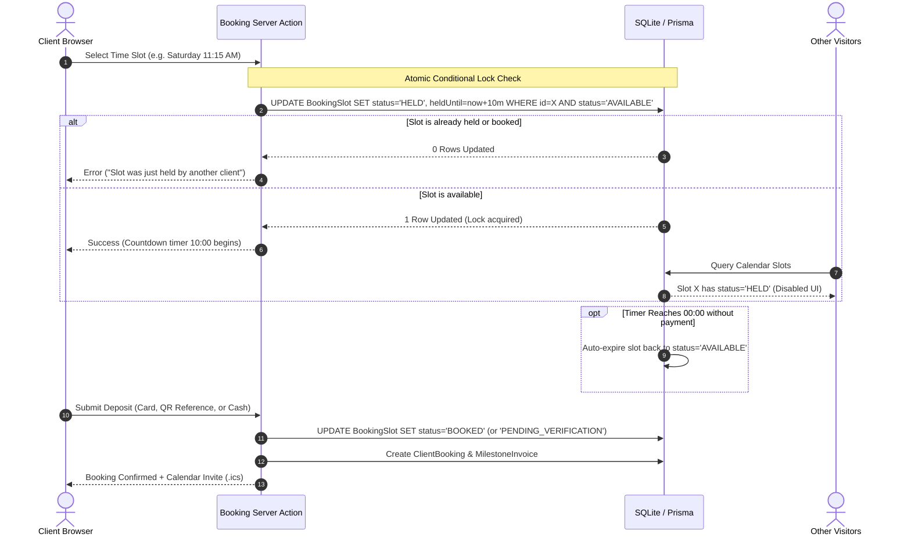
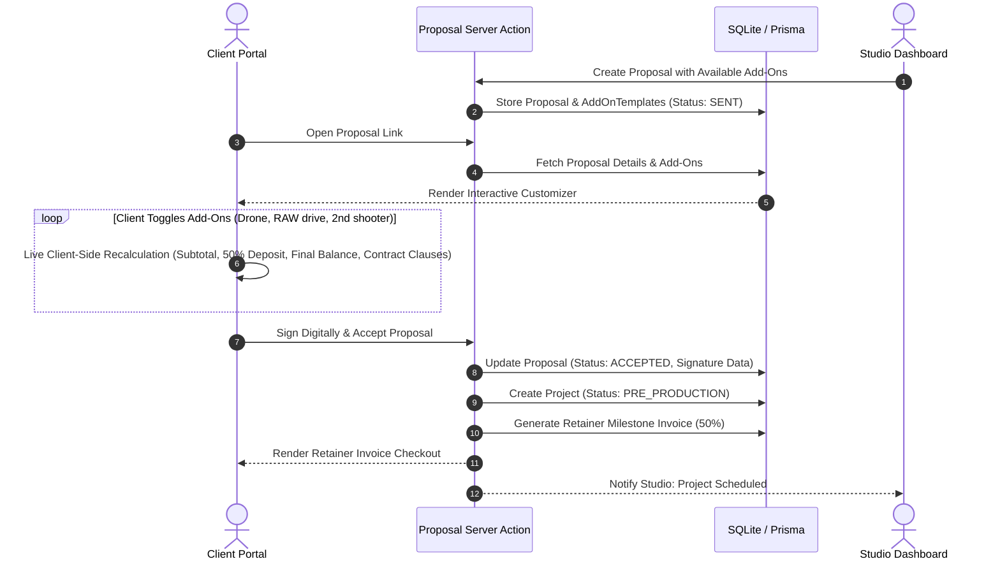
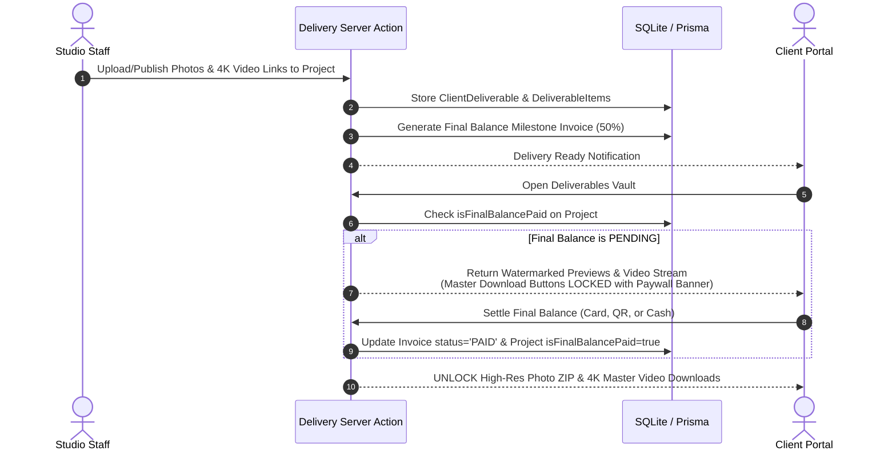
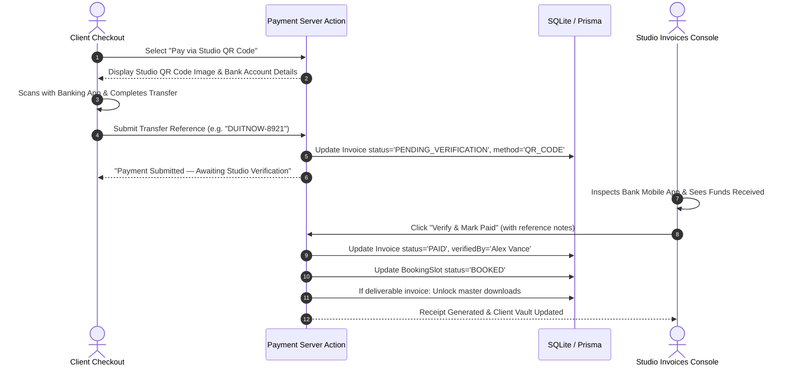
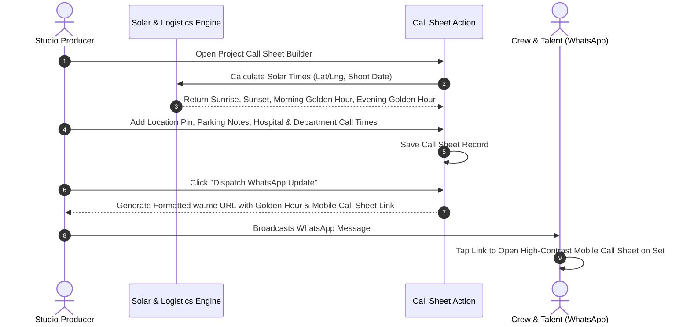

# CineFlow OS — System Architecture & Data Flows

**Document Version**: 1.0.0  
**Scope**: High-Level Architecture, Multi-Tenant Routing & Core Transactional Sequence Flows  

---

## 1. High-Level System Architecture

CineFlow OS is structured as a modular full-stack application built on Next.js 15 App Router, TypeScript, Tailwind CSS, and Prisma ORM.

---

## 2. Multi-Tenant Custom Domain & Slug Resolution

Every HTTP request passes through Next.js middleware, which inspects the `Host` header:
1. **Custom Domain Path**: If `Host` equals a registered tenant's `customDomain` (e.g. `studio.apexfilms.com`), the middleware resolves the tenant record and rewrites the path internally to `/[tenantSlug]/*`, masking the slug from the URL bar.
2. **Platform Subpath**: If `Host` is the platform domain (e.g. `cineflow.app`), requests are routed directly to `/[tenantSlug]/*` for studios or `/` for the platform marketing landing.
3. **Data Scoping Rule**: Every database query across all repositories mandates `where: { tenantId }`, ensuring zero cross-tenant data leakage.

---

## 3. Core Transactional Sequence Flows

### Flow 1: Cinema-Style Real-Time Slot Holding & Deposit Checkout

---

### Flow 2: Interactive Proposal Customization & Retainer Milestone Billing

---

### Flow 3: Direct-to-Client Delivery & Milestone Paywall Unlock

---

### Flow 4: QR Code & Cash Manual Studio Verification Flow

---

### Flow 5: Pre-Production Logistics & Mobile Call Sheet Dispatch

