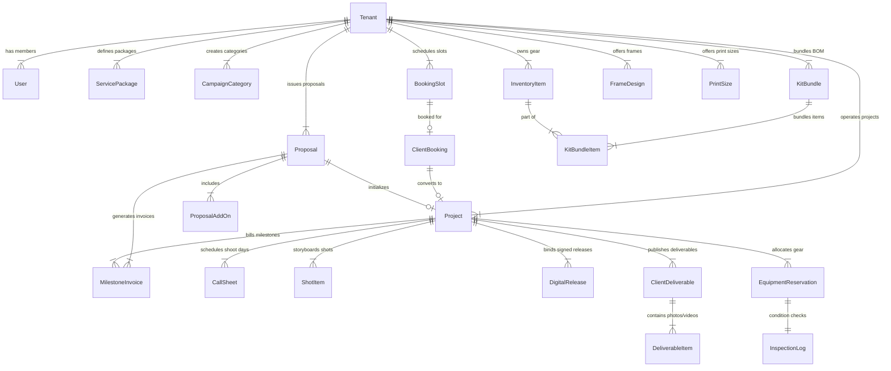

# CineFlow OS — Database Schema & Data Models

**Document Version**: 1.0.0  
**ORM**: Prisma ORM (`prisma/schema.prisma`)  
**Engines Supported**: SQLite (Embedded Local) & PostgreSQL (Cloud Production)  

---

## 1. Schema Entity Relationship Overview

---

## 2. Model Definitions & Field Specifications

### 2.1 Workspace & Multitenancy

#### `Tenant`
Represents an isolated creative studio or production company workspace.
- `id` (String, PK, CUID): Unique tenant identifier.
- `name` (String): Studio display name (e.g. "Apex Media Works").
- `slug` (String, Unique): Subpath routing key (e.g. "apex-media").
- `customDomain` (String?, Unique): Verified custom domain (e.g. "studio.apexfilms.com").
- `discipline` (String, Default: "HYBRID"): Primary focus (`PHOTOGRAPHY`, `VIDEOGRAPHY`, `HYBRID`).
- `tagline` (String?): Studio motto.
- `bio` (String?): Studio background text.
- `logoUrl` (String?): Brand logo asset.
- `brandColor` (String?, Default: "#f59e0b"): Primary brand accent color.
- `currency` (String, Default: "USD"): Base billing currency (`USD`, `MYR`, `EUR`, `GBP`).
- `qrCodeUrl` (String?): Uploaded payment QR code image for customer scan.
- `bankDetails` (String?): Bank name, account number, and holder name.
- `subscriptionTier` (String, Default: "PRO"): SaaS tier (`STARTER`, `PRO`, `STUDIO_UNLIMITED`).
- `subscriptionStatus` (String, Default: "ACTIVE"): Account status (`ACTIVE`, `TRIALING`, `CANCELLED`).

#### `User`
Studio staff, freelance crew, and registered clients.
- `id` (String, PK, CUID): Unique user ID.
- `tenantId` (String?, FK -> Tenant.id): Associated studio workspace.
- `name` (String): Full name.
- `email` (String, Unique): Account email.
- `phone` (String?): Contact phone number.
- `role` (String, Default: "CLIENT"): Role (`SUPER_ADMIN`, `STUDIO_OWNER`, `PHOTOGRAPHER`, `VIDEOGRAPHER`, `CREW`, `CLIENT`).
- `passwordHash` (String?): Bcrypt hashed password.
- `inviteToken` (String?, Unique): Token for 1-time password setup.
- `inviteTokenExpires` (DateTime?): Expiration timestamp for invite token.
- `isQuickCreated` (Boolean, Default: false): Flag indicating studio 3-field quick creation.

---

### 2.2 Booking, Campaign Categories & Cinema Slots

#### `CampaignCategory`
Dynamic category tags for seasonal and event groupings.
- `id` (String, PK, CUID): Category ID.
- `tenantId` (String, FK -> Tenant.id): Studio workspace.
- `name` (String): Display name (e.g. "Convocation 2026", "Hari Raya Festive Special").
- `slug` (String): URL tag (e.g. "convocation", "hari-raya").
- `badgeIcon` (String?): Emoji or icon identifier (e.g. "🎓", "🌙", "💍", "🎬").
- `description` (String?): Category summary.
- `isActive` (Boolean, Default: true): Whether category is visible on booking forms.
- `sortOrder` (Int, Default: 0): Display order in filter tabs.

#### `BookingSlot`
Individual calendar time slot with Cinema-Style holding.
- `id` (String, PK, CUID): Slot ID.
- `tenantId` (String, FK -> Tenant.id): Studio workspace.
- `category` (String, Default: "STUDIO_PORTRAIT"): Campaign category key.
- `campaignTitle` (String?): Optional specific campaign heading.
- `date` (DateTime): Calendar date.
- `startTime` (String): Start time string (e.g. "10:00 AM").
- `endTime` (String): End time string (e.g. "11:00 AM").
- `status` (String, Default: "AVAILABLE"): Slot status (`AVAILABLE`, `HELD`, `PENDING_VERIFICATION`, `BOOKED`, `BLOCKED`).
- `heldUntil` (DateTime?): 10-minute hold expiration timestamp.
- `heldBySessionId` (String?): Client session holding the slot.
- `price` (Float, Default: 0.0): Session price.
- `depositRequired` (Float, Default: 50.0): Deposit amount needed to lock slot.

#### `ClientBooking`
Inbound client booking reservation.
- `id` (String, PK, CUID): Booking ID.
- `tenantId` (String, FK -> Tenant.id): Studio workspace.
- `trackingCode` (String, Unique): Human-friendly code (e.g. `BK-74921`).
- `category` (String, Default: "STUDIO_PORTRAIT"): Session category.
- `clientName` (String): Contact name.
- `clientEmail` (String): Contact email.
- `clientPhone` (String): Contact phone.
- `discipline` (String): Photography, Videography, or Hybrid.
- `serviceTier` (String): Selected package name.
- `targetDate` (String?): Formatted shoot date.
- `creativeBrief` (String?): Project notes and requirements.
- `status` (String, Default: "PENDING"): Status (`PENDING`, `CONFIRMED`, `CANCELLED`).
- `depositPaid` (Boolean, Default: false): Whether deposit was received.
- `depositAmount` (Float, Default: 0.0): Paid deposit value.
- `paymentMethod` (String?): Method used (`CARD`, `QR_CODE`, `CASH`).
- `slotId` (String?, Unique, FK -> BookingSlot.id): Reserved calendar slot.
- `userId` (String?, FK -> User.id): Registered client account.

---

### 2.3 Proposals, Milestones & Payments

#### `Proposal`
Interactive digital proposal with live add-on toggling.
- `id` (String, PK, CUID): Proposal ID.
- `tenantId` (String, FK -> Tenant.id): Studio workspace.
- `proposalNumber` (String, Unique): Reference number (e.g. `PR-2026-081`).
- `clientId` (String, FK -> User.id): Recipient client.
- `studioId` (String, FK -> User.id): Creator studio owner.
- `title` (String): Proposal title.
- `category` (String, Default: "COMMERCIAL"): Project category.
- `discipline` (String): Photography, Videography, or Hybrid.
- `basePrice` (Float): Base package pricing.
- `totalPrice` (Float): Dynamically calculated total including selected add-ons.
- `depositPercentage` (Float, Default: 50.0): Retainer percentage.
- `depositAmount` (Float): Retainer deposit value.
- `finalBalanceAmount` (Float): Remaining balance value.
- `status` (String, Default: "SENT"): Status (`DRAFT`, `SENT`, `ACCEPTED`, `DECLINED`).
- `contractTerms` (String): Legal contract terms text.
- `clientSignature` (String?): Digital signature data URL.
- `signedAt` (DateTime?): Timestamp of digital signature.

#### `ProposalAddOn`
Add-on options attached to an active proposal.
- `id` (String, PK, CUID): Add-on item ID.
- `proposalId` (String, FK -> Proposal.id): Parent proposal.
- `name` (String): Add-on name (e.g. "Drone 4K Aerial Coverage").
- `description` (String): Scope description.
- `price` (Float): Unit price.
- `unit` (String, Default: "fixed"): Pricing unit (`fixed`, `per_hour`, `per_day`).
- `quantity` (Int, Default: 1): Item quantity.
- `isSelected` (Boolean, Default: false): Live toggle state.

#### `MilestoneInvoice`
Itemized milestone invoice tracking.
- `id` (String, PK, CUID): Invoice ID.
- `tenantId` (String, FK -> Tenant.id): Studio workspace.
- `invoiceNumber` (String, Unique): Code (e.g. `INV-2026-014`).
- `proposalId` (String?, FK -> Proposal.id): Originating proposal.
- `projectId` (String?, FK -> Project.id): Originating project.
- `clientId` (String, FK -> User.id): Billed client.
- `milestoneType` (String): Type (`RETAINER_50`, `FINAL_BALANCE_50`, `PRINT_FRAME_ORDER`, `BOOKING_DEPOSIT`).
- `amount` (Float): Billed sum.
- `status` (String, Default: "PENDING"): Status (`PENDING`, `PENDING_VERIFICATION`, `PAID`, `OVERDUE`).
- `paymentMethod` (String?): Method (`CARD`, `QR_CODE`, `CASH`, `BANK_TRANSFER`).
- `paymentProofUrl` (String?): Uploaded receipt proof image.
- `paymentReference` (String?): Bank transaction reference or cashier note.
- `verifiedBy` (String?): Studio staff name who verified the payment.
- `dueDate` (DateTime): Payment deadline.
- `paidAt` (DateTime?): Settlement timestamp.

---

### 2.4 Production Logistics, Call Sheets & Visual Shot Lists

#### `Project`
Core production engagement.
- `id` (String, PK, CUID): Project ID.
- `tenantId` (String, FK -> Tenant.id): Studio workspace.
- `projectNumber` (String, Unique): Reference number (e.g. `PJ-2026-022`).
- `title` (String): Project name.
- `category` (String, Default: "STUDIO_PORTRAIT"): Category tag.
- `clientId` (String, FK -> User.id): Client owner.
- `studioLeadId` (String, FK -> User.id): Lead producer or photographer.
- `discipline` (String): Photography, Videography, or Hybrid.
- `proposalId` (String?, Unique, FK -> Proposal.id): Bound proposal.
- `status` (String, Default: "PRE_PRODUCTION"): Stage (`PRE_PRODUCTION`, `PRODUCTION`, `POST_PRODUCTION`, `IN_REVIEW`, `DELIVERED`).
- `shootDates` (String?): Text representation of shoot dates.
- `budget` (Float): Total agreed budget.
- `isFinalBalancePaid` (Boolean, Default: false): Flag governing deliverables master downloads paywall.

#### `CallSheet`
Daily shoot schedule and location logistics.
- `id` (String, PK, CUID): Call sheet ID.
- `projectId` (String, FK -> Project.id): Parent project.
- `title` (String): Shoot day title.
- `shootDate` (DateTime): Shoot date.
- `generalCallTime` (String): Main crew call time (e.g. "07:30 AM").
- `locationName` (String): Venue or studio name.
- `locationAddress` (String): Physical address.
- `locationPinUrl` (String?): Google Maps / Waze direction link.
- `parkingNotes` (String?): Crew parking & staging directions.
- `hospitalName` (String?): Nearest emergency hospital.
- `hospitalAddress` (String?): Hospital physical address.
- `weatherSummary` (String?): Forecast text (e.g. "Partly Cloudy, 28°C").
- `temperature` (String?): Expected temperature.
- `sunriseTime` (String?): Computed sunrise time.
- `sunsetTime` (String?): Computed sunset time.
- `goldenHourMorning` (String?): Morning golden hour window.
- `goldenHourEvening` (String?): Evening golden hour window.
- `notes` (String?): Catering, wardrobe, or security notes.
- `crewJson` (String?): JSON roster of cast and department call times.

#### `ShotItem`
Visual shot list and storyboard card.
- `id` (String, PK, CUID): Shot ID.
- `projectId` (String, FK -> Project.id): Parent project.
- `sceneNumber` (String): Scene #.
- `shotNumber` (String): Shot #.
- `framing` (String): Wide, Medium, Close-up, Macro, Aerial.
- `cameraLens` (String): Lens spec (e.g. "50mm f/1.2", "85mm f/1.4").
- `lightingSetup` (String): Lighting setup description.
- `referenceImageUrl` (String?): Reference or storyboard sketch.
- `description` (String): Action and framing description.
- `status` (String, Default: "PENDING"): Status (`PENDING`, `IN_PROGRESS`, `COMPLETED`).
- `sortOrder` (Int, Default: 0): Sequence index.

#### `DigitalRelease`
Mobile-signed talent and location release agreements.
- `id` (String, PK, CUID): Release ID.
- `projectId` (String, FK -> Project.id): Parent project.
- `releaseType` (String): Agreement type (`TALENT`, `LOCATION`).
- `signerName` (String): Signer full name.
- `signerEmail` (String): Signer email.
- `signerPhone` (String?): Signer phone.
- `signerRole` (String?): Model, Actor, Property Owner.
- `termsContent` (String): Full legal release agreement text.
- `signatureDataUrl` (String): Base64 encoded signature image.
- `signedAt` (DateTime, Default: now()): Signing timestamp.
- `notes` (String?): ID verification or guardian notes.

---

### 2.5 Deliverables Vault & Frame Visualizer

#### `ClientDeliverable` & `DeliverableItem`
Direct delivery package for photo and video assets.
- `ClientDeliverable`:
  - `id` (String, PK, CUID): Package ID.
  - `projectId` (String, FK -> Project.id): Parent project.
  - `title` (String): Delivery title (e.g. "Final High-Res Retouched Stills").
  - `discipline` (String): Photography, Videography, or Hybrid.
  - `versionTag` (String, Default: "v1.0"): Version string.
  - `status` (String, Default: "READY"): Delivery status.
- `DeliverableItem`:
  - `id` (String, PK, CUID): Asset item ID.
  - `deliverableId` (String, FK -> ClientDeliverable.id): Parent delivery.
  - `itemType` (String): `PHOTO` or `VIDEO`.
  - `title` (String): Asset title.
  - `previewUrl` (String): Watermarked photo preview or video streaming link.
  - `downloadUrl` (String): High-res master download URL (paywall protected).
  - `thumbnailUrl` (String?): Small preview thumbnail.
  - `resolution` (String?): Resolution string (e.g. "6000x4000", "4K 3840x2160").
  - `duration` (String?): Duration string for video (e.g. "02:45").
  - `fileSize` (String?): Size label (e.g. "24 MB", "4.8 GB").
  - `isClientFav` (Boolean, Default: false): Client heart favorite flag.
  - `clientNotes` (String?): Retouch or revision notes.

#### `FrameDesign` & `PrintSize`
Interactive Print & Frame Wall Visualizer catalog.
- `FrameDesign`:
  - `id` (String, PK, CUID): Frame ID.
  - `tenantId` (String, FK -> Tenant.id): Studio workspace.
  - `name` (String): Molding name (e.g. "Matte Black Minimalist", "Warm Walnut Shadowbox").
  - `material` (String): Wood, Aluminum, Acrylic.
  - `moldingWidth` (Float): Border width in inches.
  - `frameColor` (String): Color code or texture name.
  - `previewAsset` (String): Texture or border graphic URL.
  - `priceOffset` (Float, Default: 0.0): Price markup for this molding style.
  - `isAvailable` (Boolean, Default: true): In-stock status.
- `PrintSize`:
  - `id` (String, PK, CUID): Size ID.
  - `tenantId` (String, FK -> Tenant.id): Studio workspace.
  - `code` (String): Standard industry code (e.g. "8R", "12R", "16R").
  - `name` (String): Full label (e.g. "8R (8 x 10 in)").
  - `widthInches` (Float): Width.
  - `heightInches` (Float): Height.
  - `basePrice` (Float): Base print price.

---

### 2.6 Gear Inventory & BOM (Bill of Materials)

#### `InventoryItem`, `KitBundle` & `InspectionLog`
- `InventoryItem`: Camera bodies, lenses, strobes, continuous lights, audio rigs, and drones with condition ratings (`EXCELLENT`, `GOOD`, `MAINTENANCE_NEEDED`, `DAMAGED`) and status (`AVAILABLE`, `ON_SHOOT`, `RESERVED`, `MAINTENANCE`).
- `KitBundle` & `KitBundleItem`: Standardized Bill of Materials (BOM) grouping multiple gear items into packages (e.g. "Cinema A-Cam Package", "Profoto Strobe Pack").
- `EquipmentReservation` & `InspectionLog`: Check-out and return condition logs, sensor checks, and damage notes.
