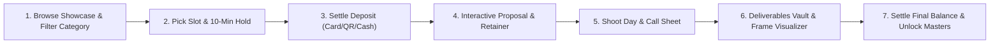

# CineFlow OS — User Journey & Operations Manual

**Document Version**: 1.0.0  
**Target Audiences**: Studio Clients, Studio Producers, Photographers, Videographers & Platform Super Admins  

---

## 1. The Client Journey: From Discovery to Master Delivery

### Step 1: Browse Showcase & Filter Category
- Client visits `cineflow.app/[tenantSlug]` or the studio's custom domain (`studio.apexfilms.com`).
- Taps category filters: `[ 🎓 Convocation ]`, `[ 🌙 Hari Raya Special ]`, `[ 💍 Wedding ]`, or `[ 🎬 Commercial ]`.
- Views high-res photos in lightbox or watches embedded video reels.

### Step 2: Pick Time Slot with Cinema-Style Hold
- Client clicks *"Book a Session"* and chooses an available calendar slot.
- **Exclusive Hold**: The slot is immediately held for **10 minutes**. A live countdown timer starts: `⏱️ 09:59 remaining`.
- Concurrently, other visitors see that slot as locked.

### Step 3: Settle Deposit (Online Card, QR Code, or Cash)
- Client fills out the ultra-lean 3-field form: Name, Email, Phone (+ Password).
- Chooses payment method:
  - *Card*: Immediate automated confirmation.
  - *Studio QR Code*: Scans studio DuitNow/Bank QR code, pastes transaction reference number.
  - *Pay Cash*: Selects cash payment at counter.
- Slot updates to `BOOKED` (or `PENDING_VERIFICATION`).

### Step 4: Customize Proposal & Settle Retainer
- For custom shoots, client opens interactive proposal link.
- Toggles add-ons (Drone, 2nd shooter, RAW drive, framed prints).
- Watches price and contract terms recalculate live.
- Signs digitally with touchscreen or mouse; settles 50% Retainer Milestone Invoice to lock the shoot date.

### Step 5: Shoot Day & Call Sheet
- Receives WhatsApp message with link to mobile-friendly Call Sheet.
- Checks call times, Golden Hour schedule, and GPS map pin.
- If talent/model, signs the mobile Digital Release form on set.

### Step 6: Deliverables Vault & Frame Visualizer
- Receives notification that photo proofs and video cuts are ready.
- Opens private vault: hearts favorite photos, leaves retouch comments, streams video.
- Opens **Interactive Frame Visualizer**: selects an 8R or 12R print, tests Matte Black vs Walnut frames over a living room wall, and orders framed prints in 1 click.

### Step 7: Settle Final Balance & Unlock Masters
- Client pays the 50% Final Balance invoice.
- Master download buttons unlock immediately: client downloads uncompressed high-res photo ZIP and pristine 4K master video files.

---

## 2. The Studio Operations Journey: Full Day-to-Day Control

### 1. Studio Configuration & Dynamic Settings (CRUD)
- In `/studio/services`: Create and edit packages, pricing, and required deposits.
- In `/studio/services/categories`: Add seasonal campaign tabs (e.g. "Convocation 2026", "Hari Raya Festive Special").
- In `/studio/frames`: Upload frame styles (Matte Black, Walnut, Gold) and configure standard print dimensions (4R to 20R).
- In `/studio/settings`: Upload studio payment QR code, enter bank account details, and set brand colors.

### 2. Schedule & Slot Management
- In `/studio/calendar`: Review master schedule.
- Batch create weekend slots for seasonal mini-sessions (e.g. generate 30 slots for Hari Raya).

### 3. Manual Payment Verification Console
- In `/studio/invoices`: Review pending QR code and cash payments.
- Match reference code with bank statement or cash in drawer.
- Click **"Verify & Mark Paid"**: Slot turns `BOOKED`, receipts issue, and deliverable paywalls drop automatically.

### 4. Pre-Production Logistics & On-Set Operations
- In `/studio/projects/[id]/call-sheet`: Generate call sheet with automatic solar golden hour calculations, GPS pins, and emergency hospital details.
- Click **"Dispatch WhatsApp Update"** to alert cast and crew.
- In `/studio/projects/[id]/shot-list`: Launch **On-Set Live Mode** on a tablet or phone. Camera operators tap shots to mark complete with a live progress gauge.
- In `/studio/projects/[id]/releases`: Present digital talent/location release forms on phone or tablet for touch signature capture.

### 5. Gear Inventory & Kit Bundles (BOM)
- In `/studio/inventory`: Allocate pre-packaged kit bundles (e.g. "Cinema A-Cam Package", "Profoto Strobe Kit") to projects.
- Perform pre-shoot check-out inspection and post-shoot return condition logging.

### 6. Direct Delivery Publishing
- In `/studio/deliveries`: Select client and project, upload photos or embed video cuts, and publish directly to the client's private vault with automatic 50% final balance paywall protection.

---

## 3. The Super-Admin Journey: Platform SaaS Management

- In `/super-admin`:
  - View total registered studios, total revenue processed, and platform Monthly Recurring Revenue (MRR).
  - Inspect tenant directory (`Lumina CineWorks`, `Apex Media`, etc.) with subscription status (`STARTER`, `PRO`, `STUDIO_UNLIMITED`).
  - One-click switch-to-tenant to provide support or inspect studio settings.
